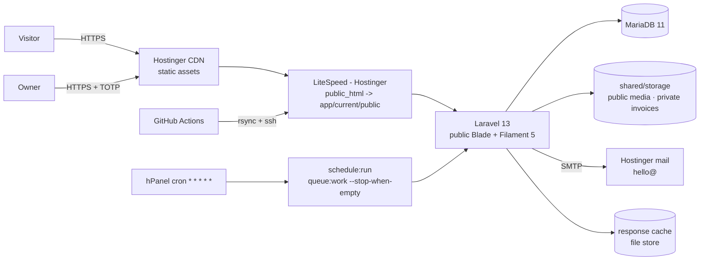
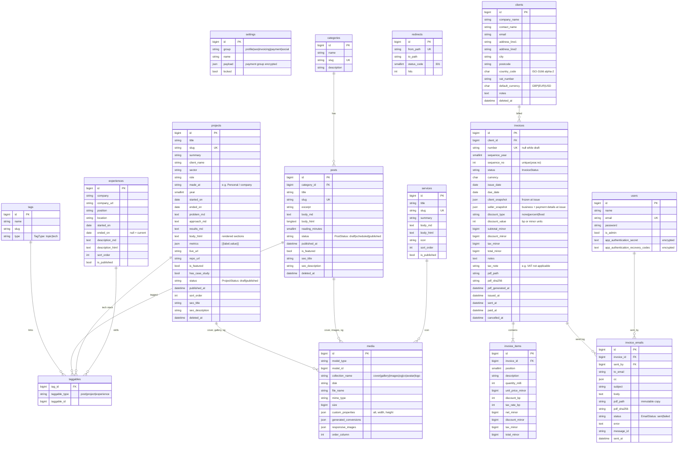

# Architecture: portfolio-v4

Status: **Proposed (Phase 1)**, 2026-11-22. Decisions are in `docs/adr/`. Scope is in `docs/PROJECT_BRIEF.md`.

## 1. Requirements summary
| Kind | Requirement |
|---|---|
| Functional (public) | Home (About, Services, Experience, Selected Projects, Latest Posts, Contact links), project archive + case studies, blog with categories/tags, CV download, sitemap/RSS/OG/JSON-LD |
| Functional (admin) | Filament CRUD for content, settings, clients, invoices (PDF, email, statuses) |
| Non-functional | Lighthouse 95+ mobile, LCP < 2.0s in the UK/EU, WCAG 2.2 AA, cookieless public pages, TOTP-protected admin |
| Constraints | Hostinger Premium shared (PHP 8.3, MariaDB 11.8, LiteSpeed, no Node or daemons, `exec`/`symlink()` disabled), one developer, about €0 extra running cost |
| Load estimate | < 10k page views/month. Admin: 1 user. Invoices: about 5–30/month. Response-cache hit rate is expected above 90%. |

## 2. High-level design

Data flows:
- **Publish:** admin save → Markdown rendered to `*_html` → OG image generated → sitemap regenerated → response cache cleared.
- **Invoice:** draft → *Issue* (number assigned, snapshots frozen, PDF generated) → *Email* (immutable PDF copy + `invoice_emails` row) → *Paid* / *Overdue* (daily job) / *Cancelled*.

## 3. Data model

Conventions: `id` bigint PK, `timestamps` on every table, slugs unique, `status` columns are backed PHP Enums, money in **integer minor units** (`*_minor` BIGINT) + `currency` CHAR(3), rates in **basis points** (`*_bp`, 2000 = 20%), quantities in **thousandths** (`quantity_milli`, 1500 = 1.5). Rendered HTML is cached in `*_html` next to its `*_md` source.

Framework tables (not shown): `sessions`, `cache`, `cache_locks`, `jobs`, `job_batches`, `failed_jobs`, `password_reset_tokens` (unused).

### Notes and trade-offs
- **Settings:** `spatie/laravel-settings` (+ Filament settings plugin) with typed classes `ProfileSettings` (name, title, tagline, about, public location, email, socials), `SeoSettings` (defaults, default OG image path), `InvoiceSettings` (prefix `INV`, default due days, default currency, default tax rate 0, tax note, footer), and `PaymentSettings` (business name/address, bank/Wise/PayPal details, **encrypted**). Single-file site assets (CV, avatar, invoice logo, default OG) are stored as settings file paths via Filament `FileUpload`, not media rows. This avoids a fake singleton model. *Revisit* if responsive avatars are needed.
- **Tags with `type`:** one polymorphic table serves blog topics (`topic`) and the tech stack (`tech`) for projects and experience. It avoids two near-identical tables. Tag archive routes use only `topic`.
- **Experience:** `ended_on = null` means current. There is no separate `current` flag (avoids contradictory states).
- **Projects:** `has_case_study=false` projects appear in the archive but link to the live URL instead of a detail page.
- **Invoice numbering (`INV-2026-0001`):** drafts have **no number**. On *Issue*, a transaction runs `SELECT MAX(sequence_no) … WHERE sequence_year=? FOR UPDATE`, then +1 and a unique index `(sequence_year, sequence_no)`. This gives gap-free, sequential numbers as UK/EU practice expects. Issued invoices are **locked**: items, amounts and snapshots are read-only, and corrections are made by cancel + reissue (or a credit note, out of scope).
- **Invoice maths** (`App\Domain\Invoicing\InvoiceCalculator`, pure and unit-tested first):
  1. `net = round_half_up(quantity_milli × unit_price_minor / 1000)`
  2. `line_discount = round_half_up(net × discount_bp / 10000)`
  3. The invoice-level discount (percent or fixed) is **allocated pro rata** across lines by taxable amount using the largest-remainder method, so allocations sum exactly to the discount and tax is computed on the discounted amount.
  4. `line_tax = round_half_up(taxable × tax_rate_bp / 10000)`, rounded **per line**.
  5. Totals are sums of line values. Every amount uses the invoice currency (2 decimal places for GBP/EUR/USD, via `brick/money` contexts).
- **Statuses** (`InvoiceStatus`): `Draft → Issued(Sent) → Paid`, `Sent → Overdue` (daily job when `due_date < today`), `Overdue → Paid`, and any non-paid status → `Cancelled`. *Sent* is set by a successful email or a manual "mark as sent". A transition guard rejects illegal transitions.

## 4. Route map

### Public (middleware group `public`: no session, no cookies, no CSRF, response-cached)
| Method | Path | Name | Notes |
|---|---|---|---|
| GET | `/` | home | Sections from settings, services, experience, featured projects, latest 3 posts |
| GET | `/projects` | projects.index | All published, ordered |
| GET | `/projects/{project:slug}` | projects.show | Case study, prev/next, CreativeWork JSON-LD. 404 if no case study. |
| GET | `/blog` | posts.index | `?page=` paginated |
| GET | `/blog/{post:slug}` | posts.show | Article JSON-LD, reading time |
| GET | `/blog/category/{category:slug}` | posts.category | |
| GET | `/blog/tag/{tag:slug}` | posts.tag | `type=topic` only |
| GET | `/cv` | cv | Streams the CV PDF from settings path. 404 if none. |
| GET | `/feed.xml` | feed | RSS 2.0 (spatie/laravel-feed) |
| GET | `/sitemap.xml` | (static file) | Generated (ADR-0006) |
| GET | `/robots.txt` | robots | Env-aware (staging disallows all) |
| GET | `/up` | health | Laravel health + release id + last scheduler run |
| * | fallback | — | `redirects` lookup (301 + hit count), else the 404 view |

Trailing-slash and `www` are redirected to the apex canonical (`public/.htaccess` rule plus a Laravel fallback).

### Admin (Filament, `/{ADMIN_PATH}`, default `/admin`; `web` + auth + MFA)
| Area | Resource / page | Key actions |
|---|---|---|
| Dashboard | Widgets | Outstanding total per currency, overdue list, recent posts |
| Content | Services, Experiences, Projects, Posts, Categories, Tags | Reorder, publish/unpublish, preview, featured |
| Site | Settings pages: Profile, SEO, Invoicing, Payment | CV/avatar/logo upload |
| Site | Redirects | CRUD |
| Billing | Clients | CRUD, view invoices |
| Billing | Invoices | Create/edit draft, **Issue**, Generate/Regenerate PDF, Download, **Email**, Mark sent / paid, Cancel, Duplicate |
| Account | Profile, MFA setup, recovery codes | — |

Also: `/livewire/*` (Filament transport, behind the same Access rule), and `GET /{ADMIN_PATH}/invoices/{invoice}/pdf`, which uses the auth policy and streams from the private disk.

## 5. Security model

| Asset | Threat | Control |
|---|---|---|
| Admin account | Credential stuffing, brute force | Required TOTP + recovery codes, Filament login throttle, app-level IP throttle on the login POST, no registration or reset routes, optional hPanel IP blocking (ADR-0007) |
| Client PII, invoices | Unauthorised read | Private disk only, policy-checked download route, unpredictable admin path, encrypted payment settings, no PII in logs |
| Secrets | Repo leak | `.env` only on the server (`chmod 600`), GitHub Environment secrets, `.gitignore` covers `.env*`, dumps and the export JSON. `composer audit` + Dependabot. |
| Public pages | XSS via content | CommonMark `html_input: 'escape'`, `allow_unsafe_links: false`. Blade escapes by default. Strict **CSP** with Vite nonces on public pages (`default-src 'self'`, Cloudflare Insights beacon allowed, `frame-ancestors 'none'`). |
| Admin pages | XSS / clickjacking / CSRF | Laravel CSRF, `SameSite=Lax` secure cookies, admin CSP (Livewire/Alpine-compatible), `X-Frame-Options: DENY` |
| Uploads | Malicious files | MIME + extension allow-lists, size limits, files served from `storage/` (no PHP execution: `.htaccess` `php_flag engine off` / `RemoveHandler` in `storage`) |
| Deploy channel | Key theft, MITM | Dedicated CI key, pinned host key, production needs manual approval (ADR-0003) |
| Mail | Spoofing, poor deliverability | SPF, DKIM, DMARC (`p=quarantine`) for the domain, checked in hPanel (Emails → DNS) |
| Shared account | Collateral damage to other sites | Deploy script confined to `$DEPLOY_PATH`, CLAUDE.md server-safety rules, owner approval for every server write |

Global headers (middleware): `Strict-Transport-Security: max-age=31536000; includeSubDomains` (once HTTPS is confirmed on both sites), `X-Content-Type-Options: nosniff`, `Referrer-Policy: strict-origin-when-cross-origin`, `Permissions-Policy: camera=(), microphone=(), geolocation=()`.

## 6. SEO
- **Meta:** the `<x-seo>` component sets the title (`{page} · Chinmoy Biswas`), description, canonical (absolute, apex, no query except `page`), `og:*`, `twitter:card=summary_large_image`, `article:published_time`/`modified_time` for posts. Staging is `noindex`.
- **OG images:** 1200×630 PNGs generated on save (Intervention/GD) from the title, type label and accent colour, stored as an `og` media collection. An uploaded override wins. The fallback is the default from SEO settings.
- **JSON-LD** (`spatie/schema-org`): `Person` + `WebSite` on home, `BlogPosting` on posts, `CreativeWork` on case studies, and `BreadcrumbList` on detail pages.
- **Sitemap:** home, `/projects`, case studies, `/blog`, posts, categories, tags with posts. `lastmod` = `updated_at`.
- **RSS:** `/feed.xml`, latest 20 published posts, full content, linked via `<link rel="alternate">`.
- **Redirects:** the `redirects` table (admin-managed) for old URLs. The old site is a Vue SPA in WordPress, so collect its indexed URLs from Search Console or `site:` before cutover (Phase 5).
- **Performance:** see ADR-0008. Budgets are in `docs/TESTING.md`.

## 7. Scale, reliability, monitoring
- The response cache makes origin load trivial. MariaDB stays tiny (hundreds of rows).
- **Backups:** Hostinger daily backups + a pre-deploy `mysqldump` option + a pre-cutover full backup. Restore steps go in the Phase 5 runbook.
- **Monitoring:** a free uptime check on `/up` (for example UptimeRobot), Laravel `daily` logs (14 days), and failed jobs visible in admin.
- **Revisit when:** many more users or comments, or a contact form is added (needs spam protection and possibly sessions on the public side). Also if the invoice volume needs credit notes or multi-user access.
